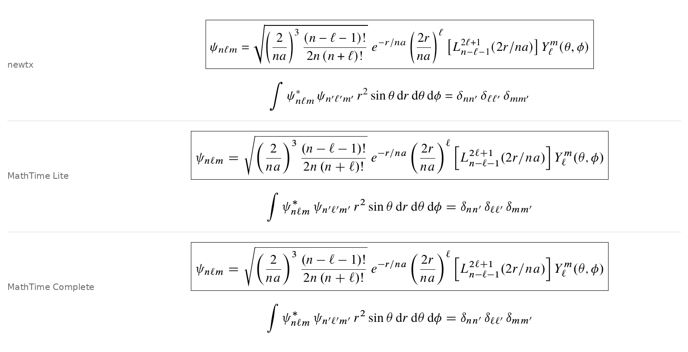

# Thesis template

A LaTeX template for a TU Delft PhD dissertation, built on the `memoir` class. It produces four editions of the same pages, with the same page numbers: a digital edition for the screen and the repository, one for the professional printer (with bleed, crop marks and thumb tabs), the printed book as it looks after trimming, and a proof to print at home on A4 or US Letter.

## Compiling

Compile with **LuaLaTeX**. In Overleaf: *Menu → Settings → Compiler → LuaLaTeX*. Locally, `latexmk main.tex` does everything (the included `latexmkrc` selects LuaLaTeX).

- LuaLaTeX lets `microtype` stretch letters very slightly, which halves the number of hyphenated lines and gives evener word spacing.
- The bibliography uses **biblatex + biber**, which Overleaf runs automatically. The nomenclature needs no extra tool.
- The first compile on a new machine (or a new Overleaf project) takes longer while LuaLaTeX builds its font cache.
- XeLaTeX also works (it is somewhat faster), but the class prints a warning as a reminder.

## Faster compiling

A long thesis gets slow because every chapter, figure and plot is processed on every compile. While writing:

1. **Compile only the chapter you are working on.** In `main.tex`, uncomment `\includeonly{...}` and list the chapter(s), for example `\includeonly{Chapters/03Method}`. Page numbers and references to the other chapters are kept from the last full compile. Comment it out again for a full compile. (Chapters must be added with `\include{...}`, not `\input{...}`, for this to work.)
2. **Use the `draft` option.** Images are replaced by labelled boxes, overfull lines get a black bar in the margin, lines are numbered in the margin (so readers can point at "p. 12, l. 31"), and every page says *DRAFT* with the date. Remove it for the final version. Overleaf's *Recompile → Fast [draft]* does the image part as well.
3. **Keep heavy plots out of the document.** Make plots in Python (matplotlib) or similar and include them as PDF. A TikZ drawing is redrawn on every compile, so keep TikZ for small diagrams.
4. **Keep images light.** Use vector PDF for plots and diagrams. For photos and renders, use JPG (or PNG for screenshots) at no more than about 300 dpi at the size they are printed: a figure 100 mm wide needs about 1200 pixels, not 6000.
5. **Load only what you use.** Optional packages are listed, commented out, at the bottom of `_options/packages.tex`.

(Automatic caching of TikZ pictures with the `memoize` package was tested and left out: it clashes with biblatex and depends on Perl modules that are not available everywhere.)

## Archival PDF (PDF/A)

The PDF is produced as **PDF/A-2u**, the archival standard: fonts are embedded, colours are defined against the sRGB colour profile, every character (maths included) maps to Unicode so text can be searched and copied reliably, and the file carries standard metadata. It will display the same in decades. This is set up in `_options/pdfa.tex` (with the `pdfx` package), which the class loads right after reading `_thesisinfo.tex`; the metadata (title, author, keywords, language) comes from `_thesisinfo.tex`, so there is nothing to edit there. LaTeX's newer route, `\DocumentMetadata`, is deliberately not used: since 2025 it also loads LaTeX's tagging code, which replaces parts of memoir (captions, headings, appendices) and makes the thesis look different on newer TeX Live versions, Overleaf included. The same PDF works for the printer and for the TU Delft repository.

- **Colours:** all template colours are RGB or grey. Use RGB (or greyscale) images and colours in your own figures as well; CMYK images break PDF/A.
- **Engine:** compile with LuaLaTeX for PDF/A. XeLaTeX still produces the same-looking PDF, but `pdfx` cannot add the XMP metadata there, so that file is not PDF/A.
- **Checking:** the template passes the standard PDF/A-2u checks with LuaLaTeX. `python3 tools/check_pdf.py` checks your compiled PDF (see *Before sending it to the printer*); it runs [veraPDF](https://verapdf.org) (free) for a full validation when that is installed, otherwise have the final PDF validated once with veraPDF or Adobe Acrobat's preflight.
- **Accessible (tagged) PDF**, the higher PDF/UA and PDF/A "a" levels, is not possible yet: the `memoir` class, the `caption` package and the `newtxmath` maths font are not yet compatible with LaTeX's tagging code, and several other packages have not been tested with it.

## Class options

Set in the first line of `main.tex`, for example:

```latex
\documentclass[print-preparation,thumb,showtrims]{personal}
```


*The same page in the four page sizes, at the same scale (print-showcase edition). The image is regenerated automatically whenever the template changes ([`.github/scripts/page_sizes.py`](.github/scripts/page_sizes.py)).*

| Option | Effect |
|---|---|
| `dover` *(default)*, `a5`, `royal`, `tudelft` | Book page size: 137 × 213 mm (the classic Dover paperback, 5⅜ × 8⅜ in), 148 × 210 mm, 156 × 234 mm or 170 × 240 mm. Text block, margins and chapter-title size follow automatically. Dover is set in 9.5 pt type on 12 pt leading (the Dover paperbacks used 11.4 pt; the extra air helps inline maths); A5 and Royal in 10 pt on 13.2 pt; TU Delft in 11 pt on 15 pt, so its wider lines stay at about the same length as the other sizes (75–77 characters). Check that your printer offers the size. |
| `digital` *(default)* | For the screen, the TU Delft repository and sharing: the pages at their final size, with links in maroon (set once in `_options/formatColor.tex`; symbols and acronyms stay black, so maths is never coloured), coloured code and sideways pages shown upright. |
| `print-preparation` | For the professional printer: the pages plus 2 mm bleed on every side (add `showtrims` for crop marks). |
| `print-showcase` | The printed book as it looks after trimming: the pages at their final size, as on paper. For checking the layout on screen. |
| `print-report` | For printing a proof at home: the pages centred on an A4 sheet (`showtrims` marks where to cut). |
| `letter` | With `print-report`: US Letter instead of A4. |

The print editions are set for paper: links invisible (they still work in the PDF), code in black and white.
| `thumb` | Chapter thumb tabs on the page edge: square, light grey with a black number; the colours are set in `_options/formatColor.tex`. Appendices continue below the last chapter; the spacing adapts so all tabs fit on the page (it uses the chapter count from the previous compile, so compile twice after adding chapters). |
| `showtrims` | Crop marks showing where the page is trimmed (`print-preparation`, `print-report`). |
| `british` *(default)*, `american` | Language: hyphenation, quotation marks and dates. |
| `showframe` | Shows the page layout frames, for checking the layout. |
| `draft` | Fast compiles while writing: images as boxes, overfull lines marked, line numbers in the margin, *DRAFT* and the date on every page. |
| `final` | The version for the printer and the repository: hides all todo notes. |
| `backreferences` | Each reference in the bibliography ends with the pages it is cited on: "(cited on pages 12, 45)". |
| `chapterbib` | Every chapter ends with its own reference list instead of one list at the end of the book, as is common for a thesis built from papers. |

## Where things are

| File | Contents |
|---|---|
| `main.tex` | Document structure: which chapters are included, in which order, and `\includeonly` for compiling single chapters. |
| `_thesisinfo.tex` | **Fill this in:** title, author, defence date, Rector Magnificus, doctoral committee, keywords, printer, ISBN, an optional dedication. Used on the title pages, CV and in the PDF metadata; leave an optional field empty, `{}`, to leave it out. |
| `_titlepage.tex` | Title page, official TU Delft dissertation page, committee and colophon page. |
| `Chapters/` | Front matter (`00…`), chapters (`01…`, `02…`), appendices (`A_…`) and back matter (`Z_…`). |
| `Chapters/02Examples.tex` | Demonstrations of everything the template supports. Take it out of `main.tex` when you start writing, but keep the file to look things up. |
| `Chapters/03InfSup.tex` | A sample chapter on a real topic (the inf-sup condition for Navier–Stokes), showing the template in use: formulations, lemmas and proofs, an algorithm, a TikZ figure, a table, citations. |
| `Chapters/_newChapter.tex` | Starting point for a new chapter: copy it, rename it and `\include` it in `main.tex`. |
| `_hyphenation.tex` | Hyphenation of words TeX breaks wrongly or not at all (technical terms, names). Add to it as you write. |
| `_nomenclature.tex` | **Fill this in:** acronyms and symbols for the nomenclature. |
| `Chapters/00Nomenclature.tex` | Prints the nomenclature lists. |
| `references.bib` | Bibliography database. |
| `personal.cls` | The class: page layout, options, core packages. |
| `_options/` | Fonts, heading styles, page styles, colours, extra packages, custom commands. |
| `Fonts/` | Optional: MathTime Professional 2 for the maths (see `Fonts/README.md`). Never put it in a public repository. |
| `tools/` | `check_pdf.py` checks the compiled PDF before submission; `check_figures.py` checks each figure's printed size, text size and fonts; `check_bib.py` tidies `references.bib`; `check_hyphenation.py` lists the hyphenated words to review; `greyscale_preview.py` counts colour pages and shows the thesis in greyscale; `diff_versions.py` makes a PDF with the changes since an earlier version marked; `mtpro2_unicode.py` and its table prepare MathTime Professional 2 (see `Fonts/README.md`); `hooks/pre-commit` refuses commits with MathTime files. |
| `requirements.txt` | Python packages for the scripts and plots: `pip install -r requirements.txt`. |
| `latexmkrc` | latexmk settings: LuaLaTeX, and the `Fonts/` folder on TeX's search paths. |
| `propositions.tex` | The propositions (stellingen), a separate document. |
| `cover.tex` | The book cover (back, spine, front) with the spine width calculated from the page count. |

## Starting your thesis

1. **Your own copy.** Make a new, private repository for the thesis from this template (on GitHub: *Use this template*, or duplicate the repository) and link it to a new Overleaf project. Keep the template repository as it is, so fixes can be copied over later. In your local clone, run `git config core.hooksPath tools/hooks` once: git then refuses any commit that contains MathTime font files (see *Maths font* below).
2. **Details.** Fill in `_thesisinfo.tex`: title, names, committee, defence date, keywords, licence, ORCID, data availability. Check the class options at the top of `main.tex` (page size, edition, language).
3. **Front and back matter.** Replace the placeholder text in `Chapters/00Summary.tex` (summary and samenvatting), `00Preface.tex`, `Z_Acknowledgements.tex`, `Z_CurriculumVitae.tex` and `Z_ListOfPublications.tex`.
4. **Remove the examples.** In `main.tex`, delete the lines `\include{Chapters/02Examples}` and `\include{Chapters/03InfSup}` (keep the files for reference), the references they use from `references.bib`, and, once no chapter uses `\lipsum` any more, the `lipsum` line. Replace the example appendix `A_Appendix.tex` with your own or remove its `\include`.
5. **Your chapters.** Turn `01Introduction.tex` into your introduction, and copy `Chapters/_newChapter.tex` for every further chapter (`03Name.tex`, ...), adding an `\include` line for each in `main.tex`.
6. **References, symbols, hyphenation.** Replace the entries in `references.bib`, define your acronyms and symbols in `_nomenclature.tex`, and add technical terms to `_hyphenation.tex` as you go (`tools/check_hyphenation.py` shows which words TeX hyphenated). Now and then, run `python3 tools/check_bib.py`: it finds duplicate entries, unused ones, missing fields and page ranges written with a hyphen, and with `--doi` it looks up missing DOIs on Crossref (`--write` adds the certain fixes).
7. **Example files.** Delete the `Images/example_*.pdf` figures once nothing uses them; keep `Python/thesis.mplstyle` and copy `Python/example_figures.py` as a starting point for your own plots.
8. **Propositions and cover** come at the end: see *Propositions and cover* below.

## Writing

- **Cross-references:** use `\cref{...}` (gives "Figure 2.1", "Equation (2.3)", "Section 2.1") and `\Cref{...}` at the start of a sentence. For one panel of a figure, `\panelref{fig:...}{a}` gives "Figure 2.2a" with the letter inside the link.
- **Chapter titles:** they are set large and aligned right, which suits one or two short lines; keep chapter titles short (a few words) and move detail into the opening paragraph or abstract.
- **Short titles:** a long chapter title crowds the page number in the running head; give it a short version, `\chapter[title in the contents][title in the running heads]{full title}` (and `\section[short]{full}` for long section titles).
- **Captions:** give every figure, table and algorithm a short version without a full stop, `\caption[short]{Long caption.}`: only the short one appears in the list, so the lists read as even one-line entries, with no citations in them (a citation there would also take a reference number before the text cites it).
- **Tables:** `booktabs` rules (`\toprule`, `\midrule`, `\bottomrule`), no vertical lines, numbers in siunitx `S` columns so they align on the decimal point. A column of sentences is an `X` column in `tabularx` (or `xltabular` across pages): it takes the remaining width and is set ragged right automatically. Table text is set at the caption size automatically (in `table` floats, sideways tables and `xltabular`), so don't add `\small` yourself.
- **URLs, DOIs and file names** are set in typewriter: `\url{...}`, `\doi{...}` and `\orcid{...}` as links (DOIs in the references come out the same), `\file{...}` without. ISBNs stay in the text font: they are catalogue numbers of digits, not addresses. They break without a hyphen, at the points the Chicago Manual of Style recommends (before a full stop, hyphen or single slash, after a colon or double slash), so a character at a line end is never mistaken for punctuation.
- **Labels:** one prefix per kind of thing, then a short name that says what it is: `ch:` chapter, `sec:` section or subsection, `app:` appendix, `fig:` figure, `tab:` table, `eq:` equation, `form:` formulation, `alg:` algorithm, `def:` / `lem:` / `thm:` / `cor:` definitions, lemmas, theorems, corollaries. In a long thesis, add the chapter to the name (`fig:wake-velocity`, `sec:burgers-weak-form`) so labels stay unique and readable; never use numbers in labels, as they change.
- **Citations:** `\cite{key}` for [1], `\citet{key}` for "Author [1]", `\citeauthor{key}`, `\citeyear{key}`.
- **Units:** `\qty{1.225}{\kilo\gram\per\cubic\metre}`, `\num{6.02e23}`, `\unit{\metre\per\second}` (siunitx).
- **Custom maths commands** (in `_options/commands.tex`): `\vec{u}` and `\tensor{\tau}` (bold italics by default; switch both to plain italics, arrows or underlines in one place), `\grad`, `\div`, `\curl`, `\deriv{y}{x}`, `\pderiv{y}{x}`, `\sderiv{y}{t}` (material derivative), `\transpose`, `\cddot`, `\inner{v}{u}_\Omega` for $(v,u)_\Omega$, the $L^2$ inner product in weak forms (`\inner[\big]{v}{u}_\Omega` for larger brackets in displays, `\inner*{...}` to fit the contents; write time derivatives inside it as `\cpderiv{u}{t}`, which gives $\partial_t u$), and dimensionless numbers such as `\Re`, `\Ma`, `\Pr`.
- **File names:** `\file{_nomenclature.tex}` sets a file or package name in typewriter type and lets it break after `.`, `/` or `_`, so it doesn't stick out into the margin on a narrow page.
- **Formulations:** `\begin{formulation}[optional title]\label{form:...} ... \end{formulation}` sets a weak form, optimisation problem or discrete scheme apart, in upright text with a bold label, "Formulation 2.1", numbered per chapter; refer to it with `\cref{form:...}`. The word is set in `_options/packages.tex`. Name parts of the boundary once ($\Gamma_\mathrm{in}$, $\Gamma_\mathrm{wall}$) rather than nesting subscripts ($\partial\Omega_\mathcal{I}$).
- **Definitions, lemmas, theorems, proofs:** `definition`, `lemma`, `theorem` and `corollary` share one counter ("Definition 2.1", "Lemma 2.2"), `remark` is unnumbered and `proof` ends with a square (`\qedhere` puts it on the last line of a display). All upright; refer to them with `\cref`.
- **Algorithms:** `\begin{algorithm}[tbp] \caption{...}\label{alg:...} \begin{algorithmic}[1] \State ... \end{algorithmic} \end{algorithm}` gives a numbered pseudocode float, "Algorithm 2.1" (algpseudocode: `\State`, `\If`, `\For`, `\While`, `\Repeat`/`\Until`, `\Return`, `\Comment`). Refer to a line with `line~\ref{...}`. Uncomment `\listofalgorithms` in `main.tex` for a list of them.
- **Convergence tables:** errors in scientific notation with siunitx `S[table-format=1.2e-1]` columns, so mantissas and exponents line up; the observed order to two decimals. See `tab:convergence` in the Examples chapter.
- **Data, code and licence:** `_thesisinfo.tex` has the data and code availability statement, the licence (CC BY 4.0 by default) and your ORCID iD, printed on the colophon (and the ORCID in the CV). Cite data sets and software in the text as well, with `@dataset` and `@software` entries in `references.bib`.
- **Todo notes:** `\todo{...}` puts a note in the margin, `\todo[inline]{...}` in the text, `\missingfigure{...}` a placeholder figure. The class option `final` removes them all.
- **Alt text:** give every image a short description, `\includegraphics[width=..., alt={Lift coefficient against angle of attack, ...}]{...}`: what the figure shows, in a sentence or two. If `alt` is the only key and its text contains a comma, some TeX Live versions misread it and print the text instead of the image: put another key first, e.g. `scale=1, alt={...}`. It is ignored in today's PDF, but it is what screen readers will read once the thesis can be produced as tagged (accessible) PDF, so writing it as you go saves revisiting every figure later.
- **Long equations:** the Dover text is 92 mm wide, so long equations need breaking. Use `multline` for one long expression and `split` (inside `equation`) to align continuation lines on the `=`; break before an operator. See the Mathematics section of the Examples chapter. A black bar in the margin with the `draft` option shows any equation that is still too wide.
- **Figures and tables:** use `[tbp]` placement, so floats don't leave half-empty pages (`[H]`, "exactly here", needs the `float` package, commented out in `_options/packages.tex`). Set full-width blocks that are *not* inside a figure or table environment with `\noindent` in front, so they don't pick up the paragraph indent. A table or figure too wide for the page goes in a `sidewaystable` or `sidewaysfigure`: a page of its own, turned so its top is at the left edge (on left and right pages alike, the book convention), while the text keeps flowing around it; the digital edition shows that page upright in PDF viewers.
- **Acronyms and symbols:** define them once in `_nomenclature.tex` and use them with `\gls{label}`. An acronym is written out in full the first time ("blade element momentum theory (BEM)") and abbreviated afterwards; a symbol is printed as defined, in text or maths. In headings and captions, use `\glsfmtshort{label}` for acronyms. Everything defined appears in the nomenclature; delete `\glsaddall` in `Chapters/00Nomenclature.tex` to list only what the text actually uses.

  | Command | List |
  |---|---|
  | `\nomacronym{label}{SHORT}{long form}` | Acronyms |
  | `\nomdimless{label}{symbol}{description}{definition}` | Dimensionless numbers |
  | `\nomlatin[sort]{label}{symbol}{description}{dimensions}{units}` | Latin symbols |
  | `\nomgreek{label}{symbol}{description}{dimensions}{units}` | Greek symbols |
  | `\nomsuper{label}{symbol}{description}` | Superscripts |
  | `\nomsub{label}{symbol}{description}` | Subscripts |

  Symbols, dimensions and definitions are written as maths without `$...$` (dimensions with `\Lunit`, `\Munit`, `\Tunit`, `\Qunit`); write `--` for a dimensionless quantity. Latin symbols are sorted by the optional sort key (the label if none is given); Greek symbols and sub- and superscripts appear in the order they are defined.

- **A chapter based on a published paper:** see `Chapters/01Introduction.tex` for the chapter opener with an epigraph and a short abstract, followed by `\chapterbasedon{\cite{key}}{contributions}`: a note at the start of the chapter with the reference and who did what, in the [CRediT roles](https://credit.niso.org) (conceptualisation, methodology, software, writing -- original draft, ...). Committees like to see this for co-authored papers. To include the published PDF itself, uncomment `pdfpages` in `_options/packages.tex` and use `\includepdf[pages=-]{paper.pdf}`.

## Notation

Decide the notation once and keep it for the whole thesis; it drifts when chapters are written years apart. The template is set up for the following conventions; change a command in `_options/commands.tex` and the whole thesis follows.

| What | Written as | Command |
|---|---|---|
| Scalars | italic: $u$, $\nu$, $p$ | plain letters |
| Vectors and tensors | bold italic: $\boldsymbol{u}$, $\boldsymbol{\sigma}$ | `\vec{u}`, `\tensor{\sigma}` |
| Matrices and vectors of unknowns (discrete) | upright sans-serif: $\mathsf{A}$, $\mathsf{b}$ | `\mathsf{A}` |
| Differential operators | $\nabla p$, $\nabla\cdot\boldsymbol{u}$, $\nabla\times\boldsymbol{u}$ | `\grad`, `\div`, `\curl` |
| Derivatives in displays | $\dfrac{\partial u}{\partial t}$, $\dfrac{\mathrm{D}u}{\mathrm{D}t}$ | `\pderiv{u}{t}`, `\sderiv{u}{t}` |
| Derivatives inline and in weak forms | $\partial_t u$, $\partial^2_x u$ | `\cpderiv{u}{t}`, `\cpderiv[2]{u}{x}` |
| Upright constants and labels | $\mathrm{d}x$, $\mathrm{e}$, $u_\mathrm{in}$ | `\mathrm{...}` for anything that is a name, not a variable |
| Inner product | $(\boldsymbol{v}, \boldsymbol{u})_\Omega$, test function first | `\inner{\vec{v}}{\vec{u}}_\Omega` |
| Named forms | $a(\boldsymbol{v}, \boldsymbol{u})$, $c(\boldsymbol{w}; \boldsymbol{v}, \boldsymbol{u})$ | defined once, with `\coloneqq` |
| Boundary parts | $\Gamma_\mathrm{in}$, $\Gamma_\mathrm{wall}$, $\partial\Omega = \Gamma_\mathrm{in} \cup \Gamma_\mathrm{wall}$ | not $\partial\Omega_\mathcal{I}$ |
| Discrete quantities | superscript $h$: $\boldsymbol{u}^h$, $\mathcal{V}^h$ | |
| Time levels | superscript $n$: $\boldsymbol{u}^n$, $\boldsymbol{u}^{n+1}$ | |
| Dimensionless numbers | upright: $\mathrm{Re}$, $\mathrm{Ma}$ | `\Re`, `\Ma`, ... |
| Units | upright, with a thin space: $10\,\mathrm{m\,s^{-1}}$ | `\qty{10}{\metre\per\second}` (siunitx) |

Every symbol also goes in `_nomenclature.tex`, so the nomenclature doubles as a check that nothing is used for two things.

## Maths font: MathTime Professional 2 (optional)

Maths is set in newtx, a Times-style maths font included with TeX Live and Overleaf. If you own MathTime Professional 2 (Lite is free from [CTAN](https://mirrors.ctan.org/fonts/mtp2lite.zip), Complete is sold by [PCTeX](https://www.pctex.com/mtpro2.html)), the template uses it instead:

1. Put the MathTime zip (`mtp2lite.zip` or `mtp2fonts.zip`) in the main folder, as it is or unpacked.
2. Run `python3 tools/mtpro2_unicode.py`. It writes a copy of the fonts into `Fonts/` with Unicode glyph names, so the maths copies correctly and the PDF stays PDF/A.
3. Compile with LuaLaTeX through latexmk (Overleaf does this); `latexmkrc` lets TeX find the fonts in `Fonts/`.

All of the `mtpro2` package's macros then work (`\xl`…`\XXXL` operators, `\SQRT`, `\widearc`, `\bm`, `\hm`), with Complete preferred if both editions are there and Lite's missing alphabets filled in from newtx, the AMS fonts and Euler. Details are in [`Fonts/README.md`](Fonts/README.md).

How the three compare, symbol by symbol (regenerate locally with `.github/scripts/math_fonts.py`, which needs both MathTime editions):



<details><summary>Every symbol group in newtx, MathTime Lite and MathTime Complete</summary>


</details>

**The MathTime licence does not allow sharing the fonts, converted or not:** never add them to a public repository (including this template); keep them in a private project only. The `.gitignore` keeps the zips, the unpacked folders and the contents of `Fonts/` out of git. Embedding the fonts in the thesis PDF is allowed.

## Plots

Make plots in Python with the style file `Python/thesis.mplstyle` (see `Python/example_figures.py`, which makes every plot in the example chapter):

```python
import matplotlib.pyplot as plt
plt.style.use("Python/thesis.mplstyle")
```

It sets Times (or STIX, a Times-like font included with matplotlib), text at about the caption size (7.5–8.5 pt for the Dover default; add 0.5 pt for A5 and Royal, 1.5 pt for TU Delft), a default size of 91.5 mm wide, colour-blind-safe colours each with its own line style (so lines stay apart in greyscale), and PDF output with embedded TrueType fonts, as needed for PDF/A. With matplotlib 3.11 or newer, save through the `save()` helper of `example_figures.py` (or copy its two lines): newer matplotlib joins *ff*, *fi* and *fl* into ligatures that its PDF output stores as missing glyphs, which fail the PDF/A check. Make each figure at the size it will be printed, and include it with `\includegraphics{...}` without scaling, so the text in the figure keeps its size:

| Page size | Full text width | Half width (two side by side) |
|---|---|---|
| `dover` | 91.5 mm (3.60 in) | 44 mm (1.73 in) |
| `a5` | 99.5 mm (3.92 in) | 48 mm (1.89 in) |
| `royal` | 104.5 mm (4.11 in) | 50 mm (1.97 in) |
| `tudelft` | 112.5 mm (4.43 in) | 54 mm (2.13 in) |

The full widths are a little under the nominal 92/100/105/113 mm, because the class rounds the text width down to whole points (Dover: 261 pt = 91.7 mm); a figure made at the nominal width would stick out by a fraction of a millimetre.

**Checking the figures:** after compiling, run `python3 tools/check_figures.py` (it reads `main.log`, in which the class records every figure's own and printed size). For each figure it reports whether it is printed at its own size (scaling with `width=` scales the text in it too), whether it fits the text width, the printed size of the text in it (most of it should be about the caption size; below 5 pt is hard to read), fonts other than Times, and the printed resolution of PNG and JPEG files. It also lists files in `Images/` that the thesis no longer uses. The text sizes and fonts need `pikepdf` (`pip install -r requirements.txt` installs it with the plotting packages).

## Propositions and cover

Both are separate documents that use the fonts and the details in `_thesisinfo.tex`. Compile them on their own: in Overleaf open the file and choose *Menu → Main document*, then switch back to `main.tex`; locally run `latexmk propositions.tex` or `latexmk cover.tex`.

- **`propositions.tex`** prints the propositions in the thesis page size, in English with an optional Dutch page (`\dutchversionfalse` for English only), ending with the approval sentence naming the promotors (`\thesispromotors` in `_thesisinfo.tex`). Check the Doctorate Regulations for how many propositions are required and what kind.
- **`cover.tex`** lays out back, spine and front on one sheet with bleed. Set the page size, the number of pages of the final thesis PDF and the paper thickness at the top; it calculates the spine width (shown on the sheet and in the log), or takes the width the printer gives you. Text goes on the spine only when it is at least 6 mm wide. There are settings for the accent colour, a front image, the back cover text and an ISBN barcode. The red and blue guides show the trim, the spine folds and the safe area; turn them off with `\coverguidesfalse` before sending the file. Ask the printer for the paper thickness and the bleed they want, and check the result against their cover template if they have one.

## Before sending it to the printer

1. **Details:** check every line of `_thesisinfo.tex` again: names (all first names, as on your passport), title, defence date and time, Rector Magnificus, committee and order, ISBN, printer, cover designer.
2. **Final build:** compile with the `final` option (removes all todo notes) and `print-preparation`, and without `draft` (with `showtrims` if the printer wants crop marks). For the repository, compile the same with `digital`: the same pages, at their final size. Search the PDF for "??" (broken references) and "[" followed by a citation key (missing references).
3. **Check the references:** run `python3 tools/check_bib.py --doi` and fix what it reports.
4. **Check the PDF:** run `python3 tools/check_pdf.py` (it reads `main.pdf` and `main.log`; on Overleaf, download both first). It reports what printers and the repository reject: PDF/A problems, fonts not embedded (also inside figure files) or without Unicode, blurry raster images (below 300 ppi at their printed size), CMYK images, broken references and citations, missing characters and overfull boxes. Fix everything marked FAIL.
5. **Overfull lines and hyphenation:** compile once with `draft`; a black bar in the margin marks every line that sticks out. Fix them by rewording or adding words to `_hyphenation.tex`. Then run `python3 tools/check_hyphenation.py`: it lists the words TeX hyphenated and points out words split across two pages, three or more hyphenated lines in a row, names and terms broken in a doubtful place, and breaks that leave two letters on a line (`--all` lists every hyphenated word).
6. **Contents and bookmarks:** check the contents, the running heads (long titles get cut off or wrap) and the PDF bookmarks.
7. **Figures:** run `python3 tools/check_figures.py`: every figure at its printed size and legible. If the printer charges for colour pages, run `python3 tools/greyscale_preview.py` on the print edition: it lists the pages with colour (the number to quote), writes `main-grey.pdf` to look through, and names figure colours that print as the same grey.
8. **PDF/A:** the PDF should be PDF/A-2u with all fonts embedded (most printers check this; the check above, veraPDF or Adobe Acrobat's Preflight shows it).
9. **Page count and blank pages:** chapters start on a right-hand page, so blank left-hand pages are expected. Note the total page count.
10. **Cover:** set the page count and the paper thickness in `cover.tex` (or the spine width from the printer), the bleed the printer asks for, turn off the guides with `\coverguidesfalse`, and compare with the printer's cover template.
11. **Propositions:** compile `propositions.tex` separately; check the promotors' names and that the promotors have approved them.
12. **Proof copy:** ask the printer for a proof copy and check it on paper before the full run.

## After the committee's comments

The committee usually asks for corrections, and it helps to show them what changed.

- **Marked-up changes:** `python3 tools/diff_versions.py committee-draft` makes `main-diff.pdf`, with every change since that version marked: deleted text struck through in red, new text underlined in blue. Tag each version you send out (`git tag committee-draft`, then `git push origin committee-draft`); any tag, commit or branch works. It uses latexdiff and latexmk, which come with TeX Live, so run it locally (Overleaf cannot).
- **Overleaf's history** (the clock icon) compares any two versions of a file, and labelled versions make the committee draft easy to find later.
- For a short list of changes, a table in a letter (comment, response, page) is often clearer than a marked-up PDF.

## Print costs

Printers usually charge every page that contains any colour as a colour page. So the print editions keep everything that appears on many pages black and white: the thumb tabs are light grey (black ink only), links are invisible and code listings use bold and grey instead of colours. Colour in your own figures is fine; it only affects the pages they are on.

## Overleaf ↔ GitHub

This repository is synced with Overleaf (*Menu → GitHub*).

**Every push builds the thesis** (`.github/workflows/build.yml`) on the latest TeX Live and checks it: `tools/check_pdf.py` with [veraPDF](https://verapdf.org) for a full PDF/A-2u validation, and `tools/check_figures.py`. A red cross in the *Actions* tab means the PDF has something to fix; the run's *Artifacts* hold the PDF, its log and the veraPDF report for 30 days. **Push a tag** (`git tag draft-2026-10 && git push origin draft-2026-10`) and the PDF is published as a release, a fixed link for your supervisors (in a private repository, only people with access can open it). These builds use newtx for the maths, as the MathTime fonts are never on GitHub.

On every push that changes the template, a second workflow (`.github/workflows/page-sizes.yml`) compiles it in all four page sizes on the latest TeX Live and updates the page-size image above; a failed run in the *Actions* tab means the template no longer compiles. When it updates the image it adds a commit, so pull in Overleaf afterwards.

- Before editing elsewhere (locally, or with Claude), **push** from Overleaf so the repository has your latest version.
- After changes were committed to the repository, **pull** in Overleaf to bring them in.
