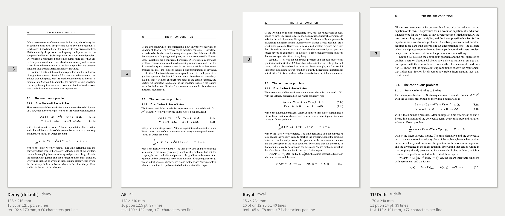
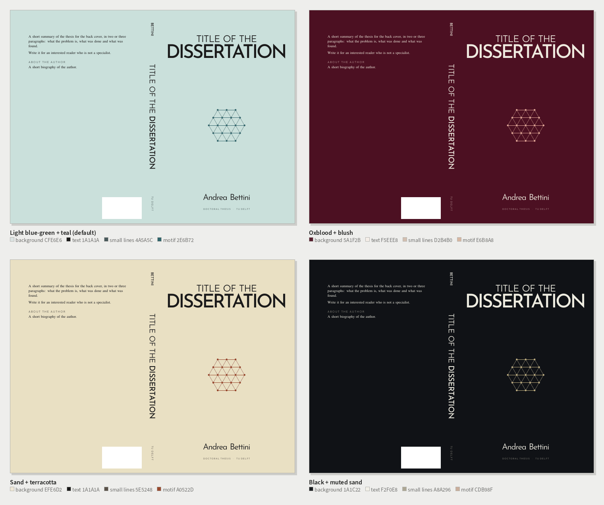

# Thesis template

A LaTeX template for a TU Delft PhD dissertation. One source gives the same pages, with the same page numbers, in four editions: a **digital** edition for the screen and the TU Delft repository (archival PDF/A-4f and accessible PDF/UA-2, with MathML for every formula), a **printer** edition (PDF/X-6 or PDF/X-4, with bleed), a **preview** of the printed book after trimming, and a **proof** to print at home. Scripts in `tools/` check the PDF, the figures, the bibliography, the hyphenation and how the thesis reads aloud with a screen reader before you hand it in.

**Sample PDFs** from the latest release, built on GitHub from this repository (maths in the bundled newtx): the [digital edition](https://github.com/abettini99/tudelft-dissertation-template/releases/latest/download/thesis-digital.pdf) (PDF/A-4f and PDF/UA-2), the [printer's file](https://github.com/abettini99/tudelft-dissertation-template/releases/latest/download/thesis-print.pdf) (PDF/X-6, with bleed), the [preview](https://github.com/abettini99/tudelft-dissertation-template/releases/latest/download/thesis-preview.pdf) (the trimmed book), the [cover](https://github.com/abettini99/tudelft-dissertation-template/releases/latest/download/cover.pdf), the [propositions](https://github.com/abettini99/tudelft-dissertation-template/releases/latest/download/propositions.pdf), [veraPDF's report](https://github.com/abettini99/tudelft-dissertation-template/releases/latest/download/verapdf-report.html) on the digital edition, and [how a PDF/UA-1 checker such as PAC sees it](https://github.com/abettini99/tudelft-dissertation-template/releases/latest/download/pdfua1-report.txt).

## What it looks like



*The same page in the four page sizes, at the same scale (preview edition). The image is regenerated overnight after any day with changes ([`.github/scripts/page_sizes.py`](.github/scripts/page_sizes.py)).*



*The cover in four colour schemes, with the template's texts; their colour values are under *Propositions and cover* below. Regenerated with the page-size image ([`.github/scripts/cover_variants.py`](.github/scripts/cover_variants.py)).*

## Getting started

Compile with **LuaLaTeX** on **TeX Live 2026**: in Overleaf, *Menu → Settings → Compiler → LuaLaTeX* and *TeX Live version → 2026*; locally, `latexmk main.tex` (the included `latexmkrc` selects LuaLaTeX and finds the template's fonts).

1. **Your own copy.** Make a private repository from this template (*Use this template* on GitHub) and link it to a new Overleaf project.
2. **Your details.** Fill in `settings/thesisinfo.tex`: title, names, committee, defence date, keywords, licence.
3. **Front and back matter.** Replace the placeholder text in `chapters/00Summary.tex`, `00Preface.tex` and the `Z_…` files.
4. **Remove the examples.** Delete the `\include` lines of `02Examples` and `03InfSup` in `main.tex` (keep the files to look things up), and the example appendix.
5. **Your chapters.** Turn `01Introduction.tex` into your introduction; copy `chapters/_newChapter.tex` for each further chapter and add an `\include` line for it.
6. **References, symbols, hyphenation.** `references.bib`, `settings/nomenclature.tex`, `settings/hyphenation.tex`.
7. **While writing,** compile with `version=draft` (or `fast-draft`, fastest); hand in and print with `version=final`, after *Before you hand it in* below.

More on each step:

- **Updating the template** to a later version (see `CHANGELOG.md`): replace `template/`, `tools/` and `thesis.cls`. Your settings, chapters and figures stay as they are, except where the changelog's migration notes say otherwise.
- **The MathTime fonts** are guarded: in a local clone, the first `latexmk` build installs a pre-commit hook that refuses any commit containing them (see *Maths font* below).
- **The examples** also have references in `references.bib` and figures in `figures/`; `tools/check_bib.py` and `tools/check_figures.py` list the unused ones once the chapters are gone.
- **The checks:** `tools/check_bib.py` finds duplicate and unused references, missing fields and DOIs; `tools/check_hyphenation.py` shows what TeX hyphenated.
- **The propositions and the cover** come last (see *Propositions and cover*).

## The structure of `main.tex`

`main.tex` lists the parts of the book and the chapters in them; the template does the rest:

```latex
\frontmatter        % title pages (from settings/thesisinfo.tex), page numbers in roman
\include{chapters/00Summary} ... \tableofcontents \listoffigures \listoftables ...
\mainmatter         % page numbers from 1, running heads, thumb tabs
\include{chapters/01Introduction} ...
\printreferences    % the reference list (with chapterbib: at the end of each chapter instead)
\appendix           % chapters lettered A, B, ...
\include{chapters/A_Appendix}
\backmatter         % acknowledgements, CV, publications
\include{chapters/Z_Acknowledgements} ...
```

- **Running heads** follow by themselves: the chapter on the left and the section on the right, or the chapter on both sides in a chapter without sections, and "Appendix A – title" in the appendices.
- **Unnumbered chapters** (`\chapter*{Preface}`) in the front and back matter get an entry in the contents by themselves.
- **The contents** go down to sections; `\setcounter{tocdepth}{2}` in the preamble of `main.tex` adds subsections.
- **Your files:** `settings/packages.tex` for your own packages, `settings/commands.tex` for your notation. The template's own are read first, by the line `\input{template/packages}`.

## Options

Set in the `\documentclass` line of `main.tex`, as keys: `\documentclass[edition=printer, version=final, size=dutch]{thesis}`. A misspelt value stops the compile with a message that lists the choices. Thumb tabs are switched on (also in the digital edition, or only in print) and styled in `settings/thumbs.tex`.

| Option | Effect |
|---|---|
| `edition=digital` *(default)* | For the screen, the TU Delft repository and sharing: the pages at their final size, archival (PDF/A-4f) and, as the final version, accessible (PDF/UA-2), with links in brick red (set once in `settings/colours.tex`; symbols and acronyms stay black, so maths is never coloured), coloured code and sideways pages shown upright. |
| `edition=printer` | For the professional printer: a PDF/X file, the pages plus bleed on every side (see *PDF standards* below; add `cropmarks` only if the printer asks for them). |
| `edition=preview` | The printed book as it looks after trimming: the pages at their final size, as on paper. For checking the layout on screen; a plain PDF (no PDF/A, tagging or attachments), so it cannot be mistaken for the printer's file. |
| `edition=proof` | For printing a proof at home: the pages centred on an A4 sheet (`cropmarks` marks where to cut). |
| `size=demy` *(default)*, `a5`, `royal`, `dutch` | Page size: 138 × 216 mm (metric demy octavo), 148 × 210 mm (A5), 156 × 234 mm (metric royal octavo) or 170 × 240 mm (the usual Dutch dissertation size). Text block, margins and type size follow: 10 pt for the first three, 11 pt for the Dutch size, so all lines hold about 65–75 characters (see *What it looks like* above). Check that your printer offers the size. |
| `english=british` *(default)*, `american` | Hyphenation, quotation marks and dates. |
| `paper=a4` *(default)*, `letter` | The sheet of the proof edition. |
| `cropmarks` | Crop marks showing where the page is trimmed: on the proof sheet, or outside the bleed (printer edition, when the printer asks for them). |
| `version=fast-draft` | While writing, compiled fastest: images as labelled boxes, overfull lines marked with a black bar in the margin, todo notes shown, *DRAFT* and the date on every page; not tagged (about 30% faster). |
| `version=draft` *(default)* | For your supervisors: the real images, todo notes and changes shown, line numbers in the margin, *DRAFT* and the date on every page; not tagged. |
| `version=final` | To hand in and to print: todo notes and change marks hidden, nothing extra on the pages, and tagged for screen readers (PDF/UA-2) in the digital and proof editions. |
| `chapterbib` | Every chapter ends with its own reference list instead of one list at the end of the book, as is common for a thesis built from papers. |

The print editions (printer, preview, proof) are set for paper: code in black and white, and links invisible (preview and proof: they still work on screen) or left out altogether (printer: a PDF/X file has nothing clickable).

## Where things are

Your files and the template's are kept apart: **`settings/`, `chapters/` and `figures/` are yours**; `template/`, `tools/` and `thesis.cls` are the template's.

```
main.tex  propositions.tex  cover.tex     the three documents
references.bib                            your bibliography
settings/      yours: thesis details, nomenclature, hyphenation, your packages and commands, colours, thumbs, cover
chapters/      yours: the chapters, front and back matter
figures/       yours: the figures; figures/plots/ the Python plot style and scripts
fonts/         optional, private: MathTime Professional 2 (never in a public repository)
thesis.cls     the class
template/      the template: packages, layout, headings, tagging, PDF/A and PDF/X, title pages, bundled fonts
tools/         checks and converters
docs/          more detail: PDF standards, the AI judge, maintaining the template
```

## Licence

The template is under the [MIT License](LICENSE): use, adapt and share it freely, keeping the licence notice in your copy of the template. Your thesis (its text, figures, data and PDF) is yours and not covered by it. Three parts keep their own terms ([EXCEPTIONS.md](EXCEPTIONS.md)): the TU Delft logo is TU Delft's trademark, to be used only as its brand guidelines allow; Josefin Sans is under the SIL Open Font License; ntxmath-otf is under the LaTeX Project Public License.

## Reference

Click a heading to open it.

<details>
<summary><b>Before you hand it in: the checklist</b></summary>

1. **Details:** check every line of `settings/thesisinfo.tex` again: names (all first names, as on your passport), title, defence date and time, the year of the defence (`\thesisyear`, for the copyright line and the metadata), Rector Magnificus, committee and order, ISBN, printer, cover designer.
2. **Final build:** compile with `edition=printer, version=final` (and `cropmarks` only if the printer wants them), with the printer's settings in `settings/thesisinfo.tex`; for the repository, the same with `edition=digital`. Search the PDF for "??" (broken references) and "[" followed by a citation key (missing references).
3. **Check the references:** run `python3 tools/check_bib.py --doi` and fix what it reports.
4. **Check the PDF:** run `python3 tools/check_pdf.py` (it reads `main.pdf` and `main.log`; on Overleaf, download both first) on both editions, and fix everything marked FAIL. On the digital edition it reports what the repository rejects (PDF/A and PDF/UA problems, fonts, blurry or CMYK images, broken references, overfull boxes); on the printer's file, trim and bleed, colour, fonts and resolution.
5. **Overfull lines and hyphenation:** compile once with `version=fast-draft`: a black bar marks every line that sticks out; reword, or add the word to `settings/hyphenation.tex`. Then `python3 tools/check_hyphenation.py` points out doubtful breaks: words split across pages, three hyphens in a row, names broken badly.
6. **Contents and bookmarks:** check the contents, the running heads (long titles get cut off or wrap) and the PDF bookmarks.
7. **Figures:** run `python3 tools/check_figures.py`: every figure at its printed size and legible. If the printer charges for colour pages, run `python3 tools/greyscale_preview.py` on the print edition: it lists the pages with colour (the number to quote), writes `main-grey.pdf` to look through, and names figure colours that print as the same grey.
8. **How it reads aloud:** run `python3 tools/check_speech.py main.pdf` on the digital edition (or take the *speech* artifact of a GitHub build), fix what it marks FAIL, and skim `speech/spoken.txt`, the thesis as a screen reader says it. For a second opinion, see the AI judge ([docs/AI-JUDGE.md](docs/AI-JUDGE.md)).
9. **Page count and blank pages:** chapters start on a right-hand page, so blank left-hand pages are expected. Note the total page count.
10. **Cover:** set the page count and the paper thickness in `settings/cover.tex` (or the spine width from the printer), the bleed the printer asks for, turn off the guides with `\coverguidesfalse`, and compare with the printer's cover template. `cover.pdf` is a PDF/X file like the print edition; check it with `python3 tools/check_print.py cover.pdf`.
11. **Propositions:** compile `propositions.tex` separately; check the promotors' names and that the promotors have approved them.
12. **Proof copy:** ask the printer for a proof copy and check it on paper before the full run.

</details>

<details>
<summary><b>Writing: cross-references, captions, tables, maths commands, statements, figures, alt text</b></summary>

- **Cross-references:** use `\cref{...}` (gives "Figure 2.1", "Equation (2.3)", "Section 2.1") and `\Cref{...}` at the start of a sentence. For one panel of a figure, `\panelref{fig:...}{a}` gives "Figure 2.2a" with the letter inside the link.
- **Chapter titles:** they are set large and aligned right, which suits one or two short lines; keep chapter titles short (a few words) and move detail into the opening paragraph or abstract.
- **Short titles:** a long chapter title crowds the page number in the running head; give it a short version, `\chapter[title in the contents][title in the running heads]{full title}` (and `\section[short]{full}` for long section titles).
- **Captions:** give each a short version without a full stop, `\caption[short]{Long caption.}`: the lists show only the short one, so they read evenly and carry no citations.
- **Tables:** `booktabs` rules (`\toprule`, `\midrule`, `\bottomrule`), no vertical lines, numbers in siunitx `S` columns. A column of sentences is an `X` column in `tabularx` (or `xltabular` across pages), set ragged right. Table text is set at the caption size automatically; don't add `\small`.
- **URLs, DOIs and file names:** `\url{...}`, `\doi{...}` and `\orcid{...}` give links in typewriter type, `\file{...}` a file name without a link. They break at sensible points (before a full stop or slash, after a colon) without a hyphen, and never leave their last few characters alone on a line. ISBNs stay in the text font.
- **Labels:** a prefix per kind (`ch:`, `sec:`, `app:`, `fig:`, `tab:`, `eq:`, `form:`, `alg:`, `def:`, `lem:`, `thm:`, `cor:`), then a short name that says what it is, never a number: `fig:wake-velocity`.
- **Citations:** `\cite{key}` for [1], `\citet{key}` for "Author [1]", `\citeauthor{key}`, `\citeyear{key}`.
- **Units:** `\qty{1.225}{\kilo\gram\per\cubic\metre}`, `\num{6.02e23}`, `\unit{\metre\per\second}` (siunitx).
- **Maths commands** (in `settings/commands.tex`, yours to change): `\vec{u}` and `\tensor{\tau}` (bold italics by default; switch both to plain italics, arrows or underlines in one place), `\grad`, `\div`, `\curl`, `\transpose`, `\cddot`, and dimensionless numbers such as `\Re`, `\Ma`, `\Pr`.
  - *Derivatives* come from the [derivative](https://ctan.org/pkg/derivative) package: `\odv{y}{x}` (ordinary), `\pdv{u}{t}` (partial), `\mdv{u}{t}` (material, $\mathrm{D}u/\mathrm{D}t$), with the order as `\odv[2]{y}{x}` or mixed as `\pdv[order={2,1}]{u}{x,y}`, and the differentials `\odif{x}`, `\pdif{x}`, `\mdif{x}`. The compact forms `\codv`, `\cpdv`, `\cmdv` are the template's own: `\cpdv{u}{t}` gives $\partial_t u$, `\cpdv[2]{u}{x}` gives $\partial^2_x u$.
  - *Brackets that grow with their contents*: `\inner{v}{u}_\Omega` for $(v,u)_\Omega$, the $L^2$ inner product in weak forms, `\norm{x}`, `\abs{x}`, `\floor{x}`, `\ceil{x}`, `\jump{u}` and `\avg{u}` (discontinuous Galerkin), `\dual{f}{v}` for $\langle f, v\rangle$, `\set{1,2,3}`, `\Set{x \in \R}{x > 0}` and `\restrict{f}{\Gamma}` for $f|_\Gamma$. Each takes a size, `\norm[\big]{x}` (`\big`, `\Big`, `\bigg`, `\Bigg`, for displays), or a star, `\norm*{...}`, to fit the contents.
  - *Sets, constants and operators*: `\R`, `\C`, `\N`, `\Z`; `\e` and `\i`, upright as ISO 80000-2 sets them (outside maths `\i` stays the dotless i); `\tr`, `\diag`, `\rank`, `\sgn`, `\Real`, `\Imag` (real and imaginary part: `\Re` is the Reynolds number), `\E`, `\Var`, `\Cov`, `\argmin`, `\argmax`.
- **Formulations:** `\begin{formulation}[optional title]\label{form:...} ... \end{formulation}` sets a weak form, optimisation problem or discrete scheme apart, in upright text with a bold label, "Formulation 2.1", numbered per chapter; refer to it with `\cref{form:...}`. The word is set in `template/packages.tex`. Name parts of the boundary once ($\Gamma_\mathrm{in}$, $\Gamma_\mathrm{wall}$) rather than nesting subscripts ($\partial\Omega_\mathcal{I}$).
- **Definitions, lemmas, theorems, proofs:** `definition`, `lemma`, `theorem` and `corollary` share one counter ("Definition 2.1", "Lemma 2.2"), `remark` is unnumbered and `proof` ends with a square (`\qedhere` puts it on the last line of a display). All upright; refer to them with `\cref`.
- **Algorithms:** `\begin{algorithm}[tbp] \caption{...}\label{alg:...} \begin{algorithmic}[1] \State ... \end{algorithmic} \end{algorithm}` gives a numbered pseudocode float, "Algorithm 2.1" (algpseudocode: `\State`, `\If`, `\For`, `\While`, `\Repeat`/`\Until`, `\Return`, `\Comment`). Refer to a line with `line~\ref{...}`. Uncomment `\listofalgorithms` in `main.tex` for a list of them.
- **Convergence tables:** errors in scientific notation with siunitx `S[table-format=1.2e-1]` columns, so mantissas and exponents line up; the observed order to two decimals. See `tab:convergence` in the Examples chapter.
- **Data, code and licence:** `settings/thesisinfo.tex` holds the data and code availability statement, the licence, the thesis DOI and your ORCID iD, for the colophon and the PDF's metadata. Cite data sets and software as `@dataset` and `@software` entries in `references.bib`.
- **Todo notes:** `\todo{...}` puts a note in the margin, `\todo[inline]{...}` in the text, `\missingfigure{...}` a placeholder figure. The final version (`version=final`) removes them all.
- **Alt text:** give every image a sentence or two on what a reader should take from it (a trend, a shape, where something is), not how it is drawn: `\includegraphics[width=..., alt={Lift coefficient against angle of attack, ...}]{...}`. The same for `\begin{tikzpicture}[alt={...}]`, each panel, `\panel[alt={...}]{file}{label}`, and a colour bar, `\colorbar[alt={...}]{file}`. PDF/UA requires it, so write it as you go. If `alt` is the only key and contains a comma, put another key first (`scale=1, alt={...}`): some TeX Live versions misread it.
- **Long equations:** the demy text is 92 mm wide. Break long ones with `multline`, or `split` inside `equation` to align on `=`, before an operator. `version=fast-draft` marks any that is still too wide with a black bar.
- **Figures and tables:** `[tbp]` placement, so floats don't leave half-empty pages (`[H]` also works). Put `\noindent` before a full-width block that is not in a float. Too wide for the page: `sidewaystable` or `sidewaysfigure`, on a page of its own, turned (the digital edition shows it upright).
- **Grids of panels and figure pages** (`template/environments.tex`): `panels` sets plots of the same kind as a grid of equal panels, each with a letter (a), (b), ... and a short label, and one shared colour bar: `\begin{panels}[columns=3] \panel{file}{$t = 0$} ... \colorbar{file} \end{panels}` inside a figure; `\cref` to a panel gives "Figure 2.9b". With `natural`, plots that share their axes line up unscaled, with shared axis titles (`xlabel=`, `ylabel=`); `save_panels` in `figures/plots/example_figures.py` writes them. `figurepage` and `tablepage` put a figure or table on a page of its own (options `landscape`, `wide`, `continued`). For a few sub-figures with their own captions, use `subfigure`.
- **Key points, contributions and QR codes:** `keypoints` sets a short list apart between two rules (tagged as a side note), `contributions` numbers a list C1, C2, ... that `\cref` can refer to ("contribution C1"), and `\qrlink{url}` prints a QR code with the address under it, in both editions, as a link on screen, e.g. for the DOI of a data set.
- **Acronyms and symbols:** define them once in `settings/nomenclature.tex` and use them with `\gls{label}`. An acronym is written out in full the first time ("blade element momentum theory (BEM)") and abbreviated afterwards (`\Gls` for a capital, `\glspl` for plurals, `\glsreset` to write it out again); a symbol is printed as defined, in text or maths. In headings and captions, use `\glsfmtshort{label}` for acronyms. Everything defined appears in the nomenclature; delete `\glsaddall` in `chapters/00Nomenclature.tex` to list only what the text actually uses.

  | Command | List |
  |---|---|
  | `\nomacronym{label}{SHORT}{long form}` | Acronyms |
  | `\nomdimless{label}{symbol}{description}{definition}` | Dimensionless numbers |
  | `\nomlatin[sort]{label}{symbol}{description}{dimensions}{units}` | Latin symbols |
  | `\nomgreek{label}{symbol}{description}{dimensions}{units}` | Greek symbols |
  | `\nomsuper{label}{symbol}{description}` | Superscripts |
  | `\nomsub{label}{symbol}{description}` | Subscripts |

  Symbols, dimensions and definitions are written as maths without `$...$` (dimensions with `\Lunit`, `\Munit`, `\Tunit`, `\Qunit`); write `--` for a dimensionless quantity. Latin symbols are sorted by the optional sort key (the label if none is given); Greek symbols and sub- and superscripts appear in the order they are defined.

- **A chapter based on a published paper:** see `chapters/01Introduction.tex` for the chapter opener with an epigraph and a short abstract, followed by `\chapterbasedon{\cite{key}}{contributions}`: a note at the start of the chapter with the reference and who did what, in the [CRediT roles](https://credit.niso.org) (conceptualisation, methodology, software, writing -- original draft, ...). Committees like to see this for co-authored papers. To include the published PDF itself, use `\includepdf[pages=-]{paper.pdf}` (pdfpages is loaded).

</details>

<details>
<summary><b>Notation: one set of conventions for the whole thesis</b></summary>

Decide the notation once and keep it for the whole thesis; it drifts when chapters are written years apart. The template is set up for the following conventions; change a command in `settings/commands.tex` and the whole thesis follows.

| What | Written as | Command |
|---|---|---|
| Scalars | italic: $u$, $\nu$, $p$ | plain letters |
| Vectors and tensors | bold italic: $\boldsymbol{u}$, $\boldsymbol{\sigma}$ | `\vec{u}`, `\tensor{\sigma}` |
| Matrices and vectors of unknowns (discrete) | upright sans-serif: $\mathsf{A}$, $\mathsf{b}$ | `\mathsf{A}` |
| Differential operators | $\nabla p$, $\nabla\cdot\boldsymbol{u}$, $\nabla\times\boldsymbol{u}$ | `\grad`, `\div`, `\curl` |
| Derivatives in displays | $\dfrac{\partial u}{\partial t}$, $\dfrac{\mathrm{D}u}{\mathrm{D}t}$ | `\pdv{u}{t}`, `\mdv{u}{t}` |
| Derivatives inline and in weak forms | $\partial_t u$, $\partial^2_x u$ | `\cpdv{u}{t}`, `\cpdv[2]{u}{x}` |
| Upright constants and labels | $\mathrm{d}x$, $\mathrm{e}$, $u_\mathrm{in}$ | `\mathrm{...}` for anything that is a name, not a variable |
| Inner product | $(\boldsymbol{v}, \boldsymbol{u})_\Omega$, test function first | `\inner{\vec{v}}{\vec{u}}_\Omega` |
| Named forms | $a(\boldsymbol{v}, \boldsymbol{u})$, $c(\boldsymbol{w}; \boldsymbol{v}, \boldsymbol{u})$ | defined once, with `\coloneqq` |
| Boundary parts | $\Gamma_\mathrm{in}$, $\Gamma_\mathrm{wall}$, $\partial\Omega = \Gamma_\mathrm{in} \cup \Gamma_\mathrm{wall}$ | not $\partial\Omega_\mathcal{I}$ |
| Discrete quantities | superscript $h$: $\boldsymbol{u}^h$, $\mathcal{V}^h$ | |
| Time levels | superscript $n$: $\boldsymbol{u}^n$, $\boldsymbol{u}^{n+1}$ | |
| Dimensionless numbers | upright: $\mathrm{Re}$, $\mathrm{Ma}$ | `\Re`, `\Ma`, ... |
| Units | upright, with a thin space: $10\,\mathrm{m\,s^{-1}}$ | `\qty{10}{\metre\per\second}` (siunitx) |

Every symbol also goes in `settings/nomenclature.tex`, so the nomenclature doubles as a check that nothing is used for two things.

</details>

<details>
<summary><b>Plots and figures: plot style, sizes, colours, checks</b></summary>

Make plots in Python with the style file `figures/plots/thesis.mplstyle` (see `figures/plots/example_figures.py`, which makes every plot in the example chapter):

```python
import matplotlib.pyplot as plt
import thesis_fonts  # figures/plots/thesis_fonts.py

plt.style.use("figures/plots/thesis.mplstyle")
thesis_fonts.setup()  # figure text in the thesis's own fonts
...
thesis_fonts.save(fig, "figures/my_figure.pdf")
```

The style sets text at about the caption size (8–9 pt for demy, A5 and royal; add 1 pt for the Dutch size), a default size of 91.5 mm wide, and seven line colours each with its own line style (see *Colours* below). `thesis_fonts` has matplotlib set every label with LuaLaTeX, in the fonts of the text: Times, with MathTime maths when `tools/mtpro2_otf.py` has converted it into `fonts/`, otherwise newtx. So `$\alpha$` or `$\Vert\nabla\boldsymbol{e}\Vert$` in a figure is the same glyph as in the text, and the PDF stays PDF/A-ready. `thesis_fonts.save` also makes the figure ready for print: its RGB colours are declared as sRGB and its black and greys become true grey (see *PDF standards* below). `setup("newtx")` forces newtx; the figures that come with the template are made that way. Without LuaLaTeX it falls back to matplotlib's own maths in Times New Roman (or in STIX, its Times-like font, where Times New Roman is not installed). Make each figure at the size it will be printed, and include it with `\includegraphics{...}` without scaling, so the text in the figure keeps its size:

| Page size | Full text width | Half width (two side by side) |
|---|---|---|
| `demy` | 91.5 mm (3.60 in) | 44 mm (1.73 in) |
| `a5` | 99.5 mm (3.92 in) | 48 mm (1.89 in) |
| `royal` | 104.5 mm (4.11 in) | 50 mm (1.97 in) |
| `dutch` | 112.5 mm (4.43 in) | 54 mm (2.13 in) |

The full widths are a little under the nominal 92/100/105/113 mm, because the class rounds the text width down to whole points (demy: 261 pt = 91.7 mm); a figure made at the nominal width would stick out by a fraction of a millimetre.

**Colours.** One kind of palette for each kind of data:
- *Lines and categories:* the plot style's seven colours ("Earth": slate blue, brick, olive, plum, ochre, teal, charcoal), in that order, each with its own line style. All of them stand out against the white page: a contrast of 4.6:1 or more, where the accessibility rule (WCAG 2.2) asks 3:1 for lines and 4.5:1 for text. The line styles keep lines apart in greyscale and for colour-blind readers, so give every line its style (the style file does) and label lines directly or in a legend.
- *Magnitudes* (a concentration, a speed): a sequential colour map, `thesis_fonts.SEQUENTIAL` (viridis, the default; plasma is warmer), whose brightness rises evenly, so it also reads in greyscale.
- *Signed values* (vorticity, an error, a difference): a diverging map centred on zero, `thesis_fonts.DIVERGING` (RdBu_r: blue negative, red positive), with `vmin=-v, vmax=v` or `matplotlib.colors.TwoSlopeNorm(0)`, as in the vorticity example.
- Always a colour bar with a colour map. Not jet or other rainbow maps: their uneven brightness shows edges that are not in the data.
- In LaTeX, `tudelft-orange` and other light colours are fine for fills behind black text; for lines and text on white use darker ones (`darkorange` for the orange). `tools/check_figures.py` names lines and text in figures that are too light, and `tools/check_pdf.py` coloured text in the thesis.

**Checking the figures:** after compiling, run `python3 tools/check_figures.py` (it reads `main.log`, in which the class records every figure's own and printed size). For each figure it reports whether it is printed at its own size (scaling with `width=` scales the text in it too), whether it fits the text width, the printed size of the text in it (most of it should be about the caption size; below 5 pt is hard to read), fonts other than Times, and the printed resolution of PNG and JPEG files. It reports lines and text in colours too light to stand out against the white page, and lists files in `figures/` that the thesis no longer uses. The text sizes and fonts need `pikepdf` (`pip install -r requirements.txt` installs it with the plotting packages).

</details>

<details>
<summary><b>PDF standards: archival and accessible (PDF/A, PDF/UA), for the printer (PDF/X), print costs</b></summary>

The digital edition is an archival PDF, **PDF/A-4f**, and in the final version also an accessible one, **PDF/UA-2**: tagged for screen readers, with alt text for figures and MathML for every formula. The printer edition is **PDF/X-6** (or **PDF/X-4** for printers that don't take PDF 2.0). The preview edition is a plain PDF. The line `\input{template/documentmetadata}` at the top of `main.tex` sets this up; keep it. [docs/PDF-STANDARDS.md](docs/PDF-STANDARDS.md) explains each standard and what the template does for it.

**Your part, for the digital edition**

- **Alt text** for every figure, and **tables with a header row** (`\toprule` ... `\midrule`). The tagging is automatic, but screen readers can only read what you write.
- **RGB or grey** in your own figures and colours: CMYK images break PDF/A.
- **Metadata** comes from `settings/thesisinfo.tex`: title, author, keywords, the licence (`\thesislicence{CC BY 4.0}`, empty for all rights reserved), and, once filled in, the ISBN, the repository's DOI (`\thesisdoi`) and your ORCID iD. Placeholders are left out.
- **Attachments:** the citation files (`citation.bib`, `citation.ris`) are added by themselves. `\figuredata[description]{figures/plot.csv}` after an `\includegraphics` attaches a figure's data, `\panel[data={file}]` a panel's, and `\supplementfile[description]{file}` any other file. Keep them small; large data sets belong in a repository such as 4TU.ResearchData.
- **What screen readers get besides:** words in maths read as words (`\mathword{Re}`), the first table row as its header (`\tagpdfsetup{table/header-rows={1,2}}` for two), acronyms with their expansion, units in words, Dutch text marked as Dutch. A formula that reads badly (a large block matrix) gets `\formulaalt{a short description}` right before it.
- **Checking:** `python3 tools/check_pdf.py` (with [veraPDF](https://verapdf.org) installed for a full validation), then `python3 tools/check_speech.py main.pdf`, which reads the PDF as a screen reader does and writes it all to `speech/spoken.txt`. `python3 tools/check_ua1.py` explains what PAC and Acrobat report: they check the older PDF/UA-1, and flag things that are correct in PDF 2.0.
- **Known limitations** (in LaTeX, its packages or the checkers; the template's workarounds, and when they can go, are in [docs/MAINTAINING.md](docs/MAINTAINING.md)):
  - *Formulas without alternate text:* PAC reports every formula. Whether screen readers need it beside the MathML is not settled yet; give the formulas that matter most a `\formulaalt`.
  - *Large matrices (nicematrix):* their MathML is complete, but in the tagged structure their entries are empty, and some speech engines ignore cells that span rows or columns. Give a block matrix a `\formulaalt`.
  - *Numbers in siunitx `S` columns:* each is split into two formulas (0.018 is read as "0", ".018"), and every number leaves an empty copy of its formula in the structure. Where a table is mostly numbers, describe it in its caption.
  - *A few symbols:* the degree sign of `\ang` is empty in the tagged structure; the MathML has it.
  - *PAC:* it reports almost every contents entry as linking to the wrong place. The links are correct and plain LaTeX passes the same check; why the template's entries fail is not known yet.

**For the printer**

Three settings in `settings/thesisinfo.tex`; ask your printer about each:

```latex
\newcommand{\thesisprintstandard}{X-6}  % or X-4
\newcommand{\thesisprintprofile}{}      % the printer's colour profile (.icc); {} for FOGRA39
\newcommand{\thesisbleed}{2mm}          % often 2 or 3 mm
```

- **The file** has trim and bleed boxes, its colours in sRGB for the printer to convert (black and greys stay black ink only), and nothing clickable. Crop marks only if the printer asks: `cropmarks`.
- **Figures from elsewhere** (a co-author's plot): `python3 tools/print_ready.py figures/figure.pdf` makes them ready for print. Figures saved with `thesis_fonts.save` already are.
- **Check it** with `python3 tools/check_print.py main.pdf`, and with the printer's own file check.
- **If the printer wants CMYK:** `python3 tools/print_pdf.py main.pdf --profile printer.icc` writes `main-cmyk.pdf`. Ask for their profile first. PDF/X-1a is not made by the template.
- **What to ask your printer:** the PDF/X version, their colour profile, RGB or CMYK, the bleed for the pages and the cover, crop marks or not, the paper thickness (for the spine), and whether the page count must be a multiple of 4, 8 or 16.
- **Print costs:** printers charge every page with any colour as a colour page, so the print editions keep thumb tabs, links and code in black and grey. Colour in your figures only affects their pages; `tools/check_print.py` lists the pages in colour, and `tools/greyscale_preview.py` shows the thesis in grey.

</details>

<details>
<summary><b>Compiling: requirements, font cache, faster compiles</b></summary>

Compile with **LuaLaTeX** on **TeX Live 2026** or later. In Overleaf: *Menu → Settings → Compiler → LuaLaTeX*, and *TeX Live version → 2026*. Locally, `latexmk main.tex` does everything (the included `latexmkrc` selects LuaLaTeX).

- LuaLaTeX lets `microtype` stretch letters very slightly, which halves the number of hyphenated lines and gives evener word spacing.
- The bibliography uses **biblatex + biber**, which Overleaf runs automatically. The nomenclature needs no extra tool.
- The first compile on a new machine (or a new Overleaf project) takes longer while LuaLaTeX builds its font cache. If every compile stays that slow (the preamble alone taking 15 s or more, where about 6 s is normal), LuaLaTeX cannot keep its cache: run `luaotfload-tool --cache=show`, which should report a *writable path*.
- LuaLaTeX only, TeX Live 2026 or later: the class stops with a message under pdfLaTeX or XeLaTeX, or with an older LaTeX.

#### Faster compiling

A long thesis gets slow because every chapter, figure and plot is processed on every compile. While writing:

1. **Compile only the chapter you are working on.** In `main.tex`, uncomment `\includeonly{...}` and list the chapter(s), for example `\includeonly{chapters/03Method}`. Page numbers and references to the other chapters are kept from the last full compile. Comment it out again for a full compile. (Chapters must be added with `\include{...}`, not `\input{...}`, for this to work.)
2. **Use `version=fast-draft` while writing.** Images are replaced by labelled boxes, overfull lines get a black bar in the margin, the tagging for screen readers is left out (each compile about 30% faster: about 21 s instead of 30 s per pass for this template), and every page says *DRAFT* with the date. `version=draft` (the default) has the real images, and line numbers in the margin so supervisors can point at "p. 12, l. 31"; `version=final` is the one you hand in. Overleaf's *Recompile → Fast [draft]* also replaces the images by boxes.
3. **Keep heavy plots out of the document.** Make plots in Python (matplotlib) or similar and include them as PDF. A TikZ drawing is redrawn on every compile, so keep TikZ for small diagrams.
4. **Keep images light.** Use vector PDF for plots and diagrams. For photos and renders, use JPG (or PNG for screenshots) at no more than about 300 dpi at the size they are printed: a figure 100 mm wide needs about 1200 pixels, not 6000.
5. **Load only what you use.** Packages you might want are listed, commented out, in `settings/packages.tex`.

</details>

<details>
<summary><b>Maths font: MathTime Professional 2 (optional)</b></summary>

Maths is set in newtx, a Times-style maths font included with TeX Live and Overleaf, through `ntxmath-otf`: the same glyphs as OpenType maths fonts (in `template/fonts/ntxmath-otf`), so maths copies as Unicode and the tagged PDF has MathML; the pages are as with the classic newtxmath, which the class falls back to when TeX cannot see that folder (`lualatex` run without latexmk). If you own MathTime Professional 2 (Lite is free from [CTAN](https://mirrors.ctan.org/fonts/mtp2lite.zip), Complete is sold by [PCTeX](https://www.pctex.com/mtpro2.html)), the template uses it instead:

1. Unpack the MathTime zip (`mtp2lite.zip` or `mtp2fonts.zip`).
2. Run `python3 tools/mtpro2_otf.py path/to/the/unpacked/folder fonts` (needs `pip install fonttools`). It converts the fonts into OpenType maths fonts in `fonts/`, with a package that places every symbol exactly as the classic fonts do; maths copies correctly and the PDF stays PDF/A-4f.
3. Compile with LuaLaTeX through latexmk (Overleaf does this); `latexmkrc` lets TeX find the fonts in `fonts/`.

All of the `mtpro2` package's macros then work (`\xl`…`\XXXL` operators, `\SQRT`, `\widearc`, `\bm`, `\hm`), Complete or Lite, whichever the files were made from, with Lite's missing alphabets filled in from newtx, the AMS fonts and Euler. Details are in [`fonts/README.md`](fonts/README.md).

How the three compare, symbol by symbol (regenerate locally with `.github/scripts/math_fonts.py`, which needs both MathTime editions):


<details><summary>Every symbol group in newtx, MathTime Lite and MathTime Complete</summary>


</details>

**The MathTime licence does not allow sharing the fonts, converted or not:** never add them to a public repository (including this template); keep them in a private project only. The `.gitignore` keeps the zips, the unpacked folders and the contents of `fonts/` out of git. Embedding the fonts in the thesis PDF is allowed.

</details>

<details>
<summary><b>Propositions and cover</b></summary>

Both are separate documents that use the fonts and the details in `settings/thesisinfo.tex`. Compile them on their own: in Overleaf open the file and choose *Menu → Main document*, then switch back to `main.tex`; locally run `latexmk propositions.tex` or `latexmk cover.tex`.

- **`propositions.tex`** prints the propositions in the thesis page size, in English with an optional Dutch page (`\dutchversionfalse` for English only), ending with the approval sentence naming the promotors (the members with the role promotor in `settings/thesisinfo.tex`). Check the Doctorate Regulations for how many propositions are required and what kind.
- **`cover.tex`** lays out back, spine and front on one sheet with bleed. Its texts, colours and sizes are in **`settings/cover.tex`**, the drawing in `settings/coverdesign.tex`; the digital edition uses the same design for its first and last pages. Set the page size, the page count of the final thesis and the paper thickness: it works out the spine width (or takes the printer's), and puts text on the spine when it is at least 6 mm wide. The design is one colour over the whole sheet, the title in [Josefin Sans](https://fonts.google.com/specimen/Josefin+Sans) (included), a drawing on the front (`\covermotif`: TikZ or an image), the summary and a short biography on the back (`\coversummary`, `\coverbio`), and space for the ISBN barcode. The red and blue guides show the trim, the folds and the safe area: `\coverguidesfalse` before sending it. Check the result against the printer's cover template if they have one.

The cover in four colour schemes is shown at the top of this README (*What it looks like*). To use a scheme, set its four colours in `settings/cover.tex`:

| Scheme | `coverback` | `covertext` | `coversecondary` | `covermotifcolour` |
|---|---|---|---|---|
| Light blue-green + teal (default) | `CFE6E6` | `1A1A1A` (as a grey) | `4A5A5C` | `2E6B72` |
| Oxblood + blush | `5A1F2B` | `F5EEE8` | `D2B4B0` | `E6B8A8` |
| Sand + terracotta | `EFE6D2` | `1A1A1A` (as a grey) | `5E5248` | `A0522D` |
| Black + muted sand | `1A1C22` | `F2F0E8` | `A8A296` | `CDB98F` |

`covertext` is the title, name, spine and back text; `coversecondary` the small lines (*Doctoral thesis · TU Delft*, *About the author*, the spine mark). Near-black is set as a grey, `\definecolor{covertext}{gray}{0.102}`, so it prints with black ink only. These are screen colours: the printer converts them to its inks, so ask for a printed proof of the cover.

</details>

<details>
<summary><b>After the committee's comments: marked-up changes</b></summary>

The committee usually asks for corrections, and it helps to show them what changed.

- **Marked-up changes:** `python3 tools/diff_versions.py committee-draft` makes `main-diff.pdf`, with every change since that version marked: deleted text struck through in red, new text underlined in blue. Tag each version you send out (`git tag committee-draft`, then `git push origin committee-draft`); any tag, commit or branch works. It uses latexdiff and latexmk, which come with TeX Live, so run it locally (Overleaf cannot), or let GitHub do it (see *GitHub and Overleaf*).
- **Overleaf's history** (the clock icon) compares any two versions of a file, and labelled versions make the committee draft easy to find later.
- For a short list of changes, a table in a letter (comment, response, page) is often clearer than a marked-up PDF.

</details>

<details>
<summary><b>GitHub and Overleaf: builds, checks, the AI judge, syncing</b></summary>

The repository is synced with Overleaf (*Menu → GitHub*). Before editing elsewhere, **push** from Overleaf; after changes were committed elsewhere, **pull** in Overleaf.

- **Every push to main builds the thesis** (`.github/workflows/build.yml`): the printer and digital editions as the final version, `main.tex` as it is, the propositions and the cover, on TeX Live as Overleaf has it and on the latest. It runs the checks: the PDF (with veraPDF), the figures, the bibliography, the PDF/UA-1 report and the speech check. A red cross in the *Actions* tab means a PDF has something to fix; the run's *Artifacts* hold the PDFs, the logs, the reports and `speech/spoken.txt` for 30 days.
- **Push a tag** (`git tag draft-2026-10 && git push origin draft-2026-10`) or publish a release, and the final PDFs are attached to it: a fixed link for your supervisors.
- **More checks:** *Changes since a version* makes `main-diff.pdf` against your newest tag; *Text quality* checks the spelling of changed `.tex` files (add words to `.github/codespell-ignore.txt`), shows chktex's suggestions, and checks the DOIs and web addresses every Monday.
- **The AI judge** (optional) has a language model judge how the thesis reads aloud, on tags and on builds you start by hand. It sends your thesis text to the model's provider, so it needs a key you add yourself: see [docs/AI-JUDGE.md](docs/AI-JUDGE.md).
- **The other workflows** (the README images, the TeX Live image, the package watch, PAC, Ruff) serve the template itself; [docs/MAINTAINING.md](docs/MAINTAINING.md) describes them. In your own copy you can switch them off under *Actions*.
- GitHub builds use newtx for the maths: the MathTime fonts are never on GitHub.

</details>

<details>
<summary><b>Every file, one by one</b></summary>

| File | Contents |
|---|---|
| `main.tex` | Document structure: the class options, the parts of the book and the chapters in them, and `\includeonly` for compiling single chapters. |
| `settings/thesisinfo.tex` | **Fill this in:** title, author, defence date, Rector Magnificus, doctoral committee, keywords, printer, ISBN, licence, an optional dedication. Used on the title pages, CV and in the PDF metadata; leave an optional field empty, `{}`, to leave it out. |
| `settings/nomenclature.tex` | **Fill this in:** acronyms and symbols for the nomenclature. |
| `settings/hyphenation.tex` | Hyphenation of words TeX breaks wrongly or not at all (technical terms, names). Add to it as you write. |
| `settings/packages.tex` | Your own packages, with some that theses often need commented out. |
| `settings/commands.tex` | Your notation: vectors, derivatives, brackets, operators, dimensionless numbers, and anything you add. |
| `settings/colours.tex` | TU Delft colours and the link colour. |
| `settings/thumbs.tex` | Thumb tabs: on or off (in all editions, or only in the print editions), their colours and size. |
| `settings/cover.tex`, `settings/coverdesign.tex` | The cover's texts, colours and sizes, and its drawing (also used for the cover pages of the digital edition). |
| `chapters/` | Front matter (`00…`), chapters (`01…`, `02…`), appendices (`A_…`) and back matter (`Z_…`). `02Examples.tex` demonstrates everything the template supports (take it out of `main.tex` when you start writing, but keep the file to look things up); `03InfSup.tex` is a sample chapter on a real topic; `_newChapter.tex` is the starting point for a new chapter. |
| `figures/` | Figures. The `example_*` files and the `grid/` and `snapshots/` folders belong to the example chapter. |
| `figures/plots/` | `thesis.mplstyle` (the plot style), `thesis_fonts.py` (figure text in the thesis's fonts, colour maps, saving ready for print) and `example_figures.py` (the plots of the example chapter). |
| `references.bib` | Bibliography database. |
| `propositions.tex`, `cover.tex` | The propositions (stellingen) and the book cover, separate documents (see *Propositions and cover*); their layout is in `template/`. |
| `fonts/` | Optional: MathTime Professional 2 for the maths (see `fonts/README.md`). Never put it in a public repository. |
| `thesis.cls` | The class: options, page layout, core packages. (At the top level, so LaTeX finds it however the thesis is compiled.) |
| `template/` | Everything else of the template: the packages and commands it loads (`packages.tex`, `commands.tex`), the parts of the book (`matter.tex`), the layout of the propositions and cover (`propositions.tex`, `cover.tex`), fonts, headings, page styles, title pages, environments, tagging, PDF/A and PDF/X, and the bundled fonts. Each file says at its top what it does. |
| `tools/` | The checks: `check_pdf.py` (the PDF before submission; runs `check_print.py` on the printer's file), `check_figures.py`, `check_bib.py`, `check_hyphenation.py`, `check_links.py`, `check_speech.py` and `judge_speech.py` (how it reads aloud), `check_ua1.py` (what PAC sees). For the printer: `print_ready.py` (figures from elsewhere), `print_pdf.py` (CMYK), `greyscale_preview.py`. For corrections: `diff_versions.py`. For fonts: `mtpro2_otf.py` (MathTime), `ntxmath_otf.py` (maintainer). `hooks/pre-commit` refuses commits with MathTime files. |
| `requirements.txt` | Python packages for the scripts and plots: `pip install -r requirements.txt`. |
| `LICENSE`, `EXCEPTIONS.md` | The MIT License of the template, and the files it does not cover. |
| `CHANGELOG.md` | What changed in each version of the template; check it before you update yours. |
| `latexmkrc` | latexmk settings: LuaLaTeX, and the `fonts/` and `template/fonts/ntxmath-otf/` folders on TeX's search paths. |
| `.github/` | The GitHub builds (`workflows/`, see *GitHub and Overleaf*) and the images in this README. |
| `docs/` | `PDF-STANDARDS.md` (the standards in detail), `AI-JUDGE.md` (setting up the AI judge), `MAINTAINING.md` (for the template's maintainer). |

</details>
